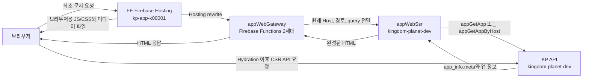

# Kingdom Planet Web SSR Gateway

이 저장소는 Firebase Functions 2세대 함수 `appWebGateway`를 관리합니다. 앱의 최초 문서 요청을 공용 SSR 함수로 전달하는 진입점입니다.

## 코드 소유 위치

| 역할 | 코드 위치 | 배포 프로젝트 |
| --- | --- | --- |
| 앱 웹 Gateway | `functions/appWebGateway/` | FE Hosting 프로젝트 `kp-app-k00001` |
| 앱 웹 SSR | `kingdom-planet-api-fb/app/function/appWebSsr.js`, `kingdom-planet-api-fb/app/function/appWebSsr/` | `kingdom-planet-dev` |
| KP 앱 정보 API | `kingdom-planet-api-fb/app/` | `kingdom-planet-dev` |

`appWebSsr` 소스와 API 배포 설정은 `kingdom-planet-api-fb`에서 관리합니다. 이 저장소에는 SSR 함수 코드와 별도 SSR 배포 설정을 두지 않습니다.

## 요청 흐름



Gateway는 문서 요청의 Host와 원래 경로·query를 보존해 `APP_WEB_SSR_URL`로 전달합니다. 브라우저용 정적 파일은 FE Hosting에서 제공하고, Hydration 이후 FE가 보내는 KP API 요청은 기존 KP API 주소로 직접 전달됩니다.

## 설정과 배포

비밀값과 로컬 `.env*` 파일은 저장소에 커밋하지 않습니다. Gateway에는 `APP_WEB_SSR_URL`과 `KP_API_BASE_URL` 설정이 필요합니다.

Gateway 배포 시에는 대상 프로젝트를 명시합니다.

```bash
firebase deploy --config firebase.app-web-gateway.json --project kp-app-k00001 --only functions
```

이 명령은 Gateway만 배포합니다. `appWebSsr` 배포는 `kingdom-planet-api-fb` 저장소의 `app` Functions 코드베이스에서 관리합니다.
